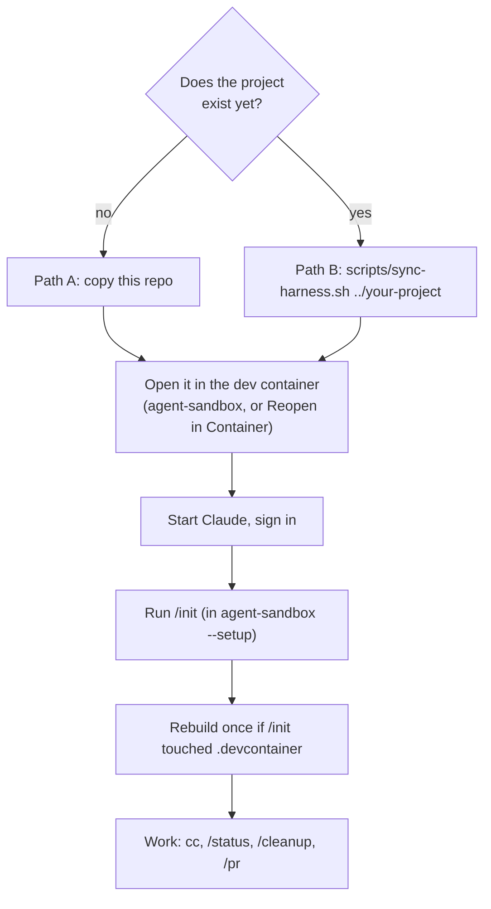
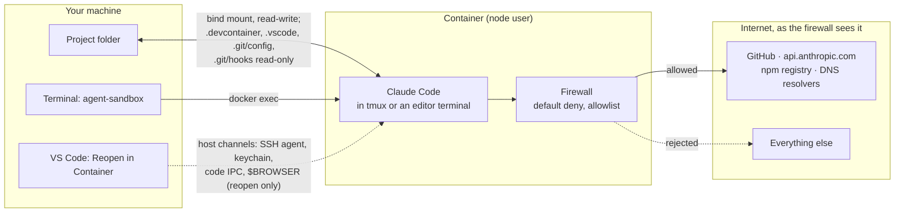
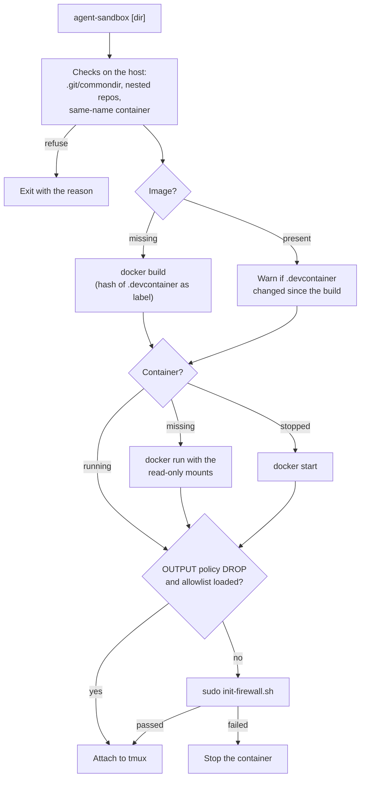
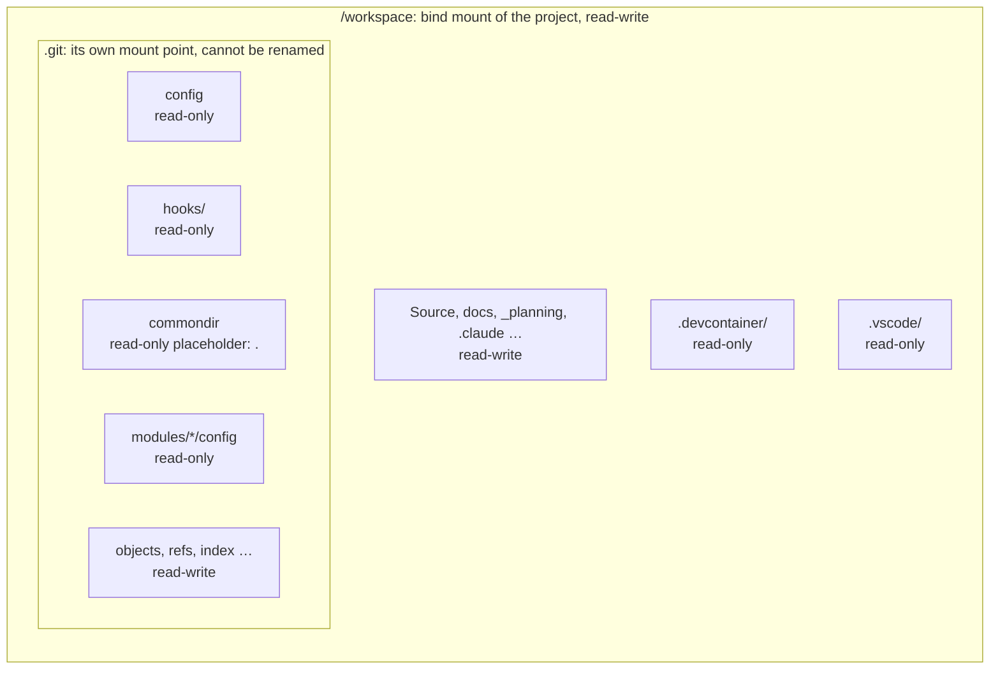
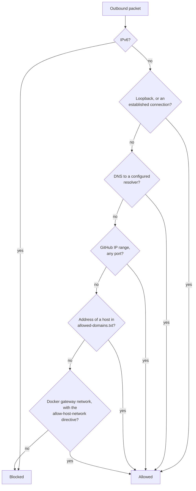
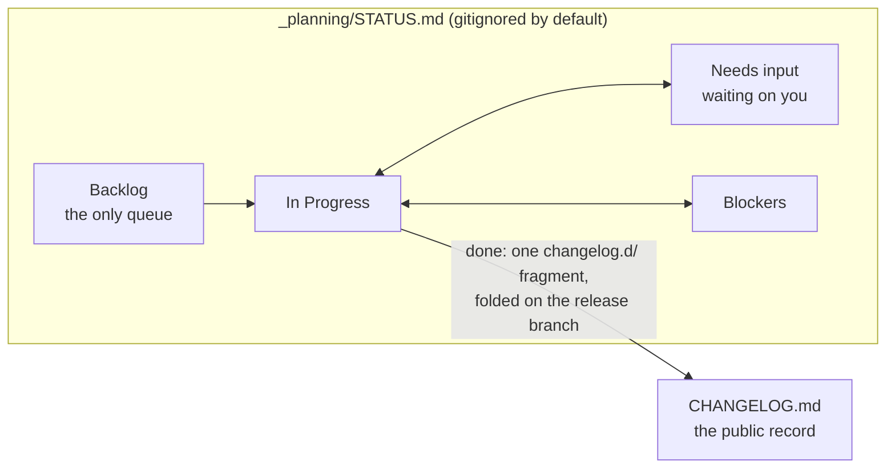

# Claude Project Boilerplate

A starting point for projects built with **Claude Code**. It ships a
preconfigured `.claude/` harness (instructions, permissions, slash commands,
subagents, hooks) and a sandboxed dev container, tuned for two goals:

- **Lower token usage.** A lean always-on `CLAUDE.md`, subagents that keep
  heavy reading out of the main context, and targeted-read conventions.
- **Approachable.** Written so a junior developer, or a non-developer, can
  follow it: plain-language docs over cleverness, with every moving part
  explained in [`.claude/README.md`](.claude/README.md).

The **harness** is not tied to one stack or language. Its commands detect
Node, Python, Rust, Go and Make-based projects out of the box, and the
permissions cover those toolchains.

The **dev container** is Node-first: only the Node toolchain is preinstalled,
and its firewall passes only npm's registry. Any other stack is one documented
rebuild away. [`.devcontainer/STACKS.md`](.devcontainer/STACKS.md) has the
recipe (toolchain, exact firewall domains, verification) for Python, Go, Rust,
Java and Ruby, and the pattern for everything else (Solidity/Foundry, Elixir,
Zig, and so on). For the smoothest ride also add your toolchain to the
`settings.json` allowlist and the detection lists in `/dev` and `/cleanup`;
each is a small markdown edit.

> **New here? Start with [`.claude/README.md`](.claude/README.md).** It
> explains the whole harness (hooks, subagents, commands, memory, state
> files) in plain language, with no prior Claude Code experience assumed.

## Contents

- [1. What's inside](#1-whats-inside)
  - [1.1 Files and folders](#11-files-and-folders)
  - [1.2 Bundled skills](#12-bundled-skills)
- [2. Getting started](#2-getting-started)
  - [2.1 Path A: start a new project from this repo](#21-path-a-start-a-new-project-from-this-repo)
  - [2.2 Path B: add the harness to an existing codebase](#22-path-b-add-the-harness-to-an-existing-codebase)
  - [2.3 Signing in](#23-signing-in)
  - [2.4 API keys and other providers](#24-api-keys-and-other-providers)
  - [2.5 Working day to day](#25-working-day-to-day)
- [3. The dev container](#3-the-dev-container)
  - [3.1 What it sets up](#31-what-it-sets-up)
  - [3.2 Not for iOS or macOS-native development](#32-not-for-ios-or-macos-native-development)
  - [3.3 Run without VS Code (recommended)](#33-run-without-vs-code-recommended)
  - [3.4 What is different inside the sandbox](#34-what-is-different-inside-the-sandbox)
  - [3.5 Compared with "Reopen in Container"](#35-compared-with-reopen-in-container)
  - [3.6 Host notes: Linux and macOS](#36-host-notes-linux-and-macos)
  - [3.7 Auditing another repository](#37-auditing-another-repository)
  - [3.8 The firewall](#38-the-firewall)
  - [3.9 Shell shortcuts](#39-shell-shortcuts)
  - [3.10 Security model](#310-security-model)
- [4. Conventions](#4-conventions)
- [5. License](#5-license)

## 1. What's inside

### 1.1 Files and folders

```
.claude/
├── CLAUDE.md          # Always-on harness instructions (synced; kept deliberately short)
├── CUSTOM.md          # Your per-project choices + deviations (never synced; wins on conflict)
├── README.md          # ★ Guide to the harness — read this first
├── settings.json      # Permissions (allow/deny), hooks (PreToolUse, SessionStart, PreCompact, SubagentStop), status line
├── commands/          # Slash commands: /init /cleanup /plans /pr /review /socratic …
├── agents/            # Subagents: explore-via-sonnet (search), review-diff, implement-scoped, docs-updater
├── skills/            # Auto-invoked skills: project-state upkeep (update-status, log, status, release), TDD, systematic-debugging, writing-plans, brainstorming, using-superpowers
├── scripts/           # usage-statusline.sh (status line), review_page.py (/review page), changelog_fold.py (folds changelog.d/ fragments), subagent_summary.py (tabulates the SubagentStop log)
└── hooks/             # PreToolUse: block_destructive.py (rm -rf/force-push variants), socket_scan.py (installs via Socket; opt-in), bounded_reads.py (no bare cat of big files) · SessionStart: first-run-check.sh, status-staleness-check.sh, plan-staleness-check.sh · PreCompact: save-context.sh · SubagentStop: log_subagent.py
.devcontainer/         # Sandboxed Docker env: Dockerfile, firewall script + allowed-domains.txt, shell shortcuts, agent-sandbox-ports, STACKS.md (see below)
scripts/               # sync-harness.sh (install/refresh the harness in another repo; --install-shell installs agent-sandbox.zsh), agent-sandbox.zsh (run the container from the host without VS Code), new-project.sh (detach a copy), tests/
changelog.d/           # One changelog fragment per change, written on branches; folded into CHANGELOG.md on the release branch
.npmrc                 # Supply-chain hardening: no install scripts, exact pins (see STACKS.md §Supply-chain hardening — incl. pnpm/cargo/go equivalents)
LICENSE                # MIT
```

### 1.2 Bundled skills

The skills in `.claude/skills/` work out of the box. Claude Code discovers any
`.claude/skills/<name>/SKILL.md` at session start, and Claude invokes the
matching one itself; there is nothing to install or call by hand.

Four of them manage project state: `update-status`, `log`, `status` and
`release`. They fire when work starts, completes or blocks, so finished items
leave STATUS.md instead of waiting for someone to run a command. You can
still type `/update-status` and the others yourself.

Five more are vendored from [Superpowers](https://github.com/obra/superpowers)
(MIT, see `.claude/skills/ATTRIBUTION.md`): `test-driven-development`,
`systematic-debugging`, `using-superpowers` (which nudges Claude to reach for
a relevant skill before answering), `writing-plans` and `brainstorming`. All
but `systematic-debugging` are modified from upstream to be **opt-in rather
than auto-firing**: plans and brainstorms ask before starting and save under
`_planning/`, TDD applies only when the project records `Testing policy:
tdd` (a per-project choice, asked once, like the commit policy), and the
skill dispatcher drops upstream's "1% chance → MUST invoke" rule.

Delete a skill's folder to remove it. If you would rather track the full,
unmodified, auto-updating upstream set, install the Superpowers _plugin_
instead.

## 2. Getting started

Two ways in, depending on whether your project already exists. Both end in
the same place.



### 2.1 Path A: start a new project from this repo

1. **Copy this repo** as the seed for your new project, or use it as a
   template.
2. **Open it in the dev container.** Either `agent-sandbox` from a host
   terminal ([3.3](#33-run-without-vs-code-recommended), the more isolated
   path), or VS Code's "Reopen in Container" after enabling it once per
   host with `touch ~/.config/zsh/agent-sandbox-allow-vscode`. The first
   start builds the image, which takes a few minutes; it installs Claude
   Code and the tools listed under [3.1](#31-what-it-sets-up). You can also
   use your own environment and skip the container-specific steps.
3. **Start Claude** in the container terminal: `cc` (the shortcut; `cc-help`
   lists the others) or plain `claude`. The first run asks you to sign in,
   see [2.3](#23-signing-in).
4. **Run `/init`** in a one-time `agent-sandbox --setup` container. `/init`
   edits `.devcontainer/` and `.git`, which both the sandbox container and
   the reopened one mount read-only; inside those it prints the edits for
   you to apply on the host instead. It offers to detach the boilerplate
   first (`scripts/new-project.sh` renames this README to `BOILERPLATE.md`,
   deletes LICENSE, resets the state files and drops the boilerplate's git
   history). Then it detects your stack and scaffolds `README.md`,
   `CHANGELOG.md`, `.gitignore`, `.gitattributes` and `_planning/`, including
   `_planning/STATUS.md`, your living status and backlog, gitignored by
   default. Along the way it asks the per-project choices once: commit and
   testing policy, STATUS.md visibility, whether the shell shortcuts skip
   permission prompts, and, for a non-Node stack, it walks you through
   [`STACKS.md`](.devcontainer/STACKS.md). Add your project's own `LICENSE`
   afterwards.
5. **Rebuild the container once** (`agent-sandbox-rebuild`, or VS Code's
   "Rebuild Container") if `/init` touched `.devcontainer/`. It renames the
   container and sets the shortcut flags in `devcontainer.json`, and a stack
   recipe edits the Dockerfile and the firewall list. Those files are baked
   into the image, so nothing applies until you rebuild. Review `git diff --
   .devcontainer` first: the rebuild runs whatever is in there.

### 2.2 Path B: add the harness to an existing codebase

Do not copy the whole repo into an existing project; its README, LICENSE and
git history would collide with yours. Instead, from a checkout of this repo
**on the host** (not inside a container, where sibling directories are not
visible):

```sh
scripts/sync-harness.sh ../your-project
```

When the target has no `.claude/` yet, the script runs in **install mode**.
After one confirmation it copies `.claude/` and `.devcontainer/`, nothing
else, and asks for the dev container's name (default: the directory name).
Your `.git`, code and README are never touched. It also strips this repo's
recorded commit and testing policies from the copied `CLAUDE.md`, so `/init`
asks you fresh.

Then open the project in its dev container, start Claude (`cc` or `claude`)
and run **`/init`**. It fills gaps without overwriting: it merges the required
`.gitignore` entries into your existing one, scaffolds `_planning/`, renames
the container, records your policies, asks about the shortcut flags, and
flags non-Node stacks (the container ships Node-only; recipes are in
[`.devcontainer/STACKS.md`](.devcontainer/STACKS.md)). Rebuild the container
once afterwards, as in Path A step 5.

Re-run the same command later to pull harness updates into the project. This
**refresh mode**:

- mirrors commands, skills, agents, hooks and the firewall script, and
  confirms deletions;
- warns about hook files your kept `settings.json` does not wire;
- splices the `Dockerfile` at its `# ==== PROJECT LAYERS ====` marker, so
  upstream fixes land while your stack layers below it stay;
- shows a diff and asks before touching files that hold per-project edits,
  such as `allowed-domains.txt` or `devcontainer.json`. Answer `u` to keep
  yours and get the boilerplate version beside it as `<file>.upstream` for a
  hand merge. Overwriting `devcontainer.json` keeps your container `"name"`
  and `CLAUDE_SHORTCUT_FLAGS`, and a copy that differs only in those two
  counts as in sync, so they are never asked about again.

Already have a `.claude/` setup you want rid of, such as a hand-rolled
harness or conventions worth abandoning? `scripts/sync-harness.sh --replace
../your-project` backs the old `.claude/` and `.devcontainer/` up to a
timestamped `tar.gz` at the project root, then installs fresh. To replace
just one file's conventions (say, a sloppy `CLAUDE.md`), plain refresh mode
is enough: answer `y` at that file's diff prompt.

### 2.3 Signing in

The first `claude` (or `cc`) in the container asks you to sign in. There is
no browser in the container, so it prints a URL: open it on your host, sign
in with your Claude subscription (Pro, Max or Team) or a Console account for
pay-per-token API billing, and paste the code back. The firewall allows the
sign-in endpoints out of the box.

Credentials live in the `~/.claude` named volume, so they survive rebuilds
and disappear only when the volume does (Docker Desktop reset, `docker
volume prune`, a container-ID change). Then sign in again. `claude auth
status`, `login` and `logout` manage it from the shell; `/login` inside a
session switches accounts.

### 2.4 API keys and other providers

**API key instead of a sign-in.** Set `ANTHROPIC_API_KEY`. Put it in the
gitignored `.claude/settings.local.json` under `"env"`, the same place `/init`
puts the Socket token, and never in `devcontainer.json` or any committed
file. Or pass a host variable through without storing it in the repo at all:
`"remoteEnv": { "ANTHROPIC_API_KEY": "${localEnv:ANTHROPIC_API_KEY}" }` in
`devcontainer.json`.

A key in the environment wins over a subscription sign-in, so a stray key on
the host silently moves you to pay-per-token billing. `claude auth status`
shows `apiKeySource` when that is happening.

**Other providers.** Claude Code can reach Anthropic's models through Amazon
Bedrock (`CLAUDE_CODE_USE_BEDROCK=1` plus AWS credentials), Google Vertex AI
(`CLAUDE_CODE_USE_VERTEX=1` plus gcloud credentials), or a compatible gateway
(`ANTHROPIC_BASE_URL`). Setup per provider is in the
[Claude Code docs](https://code.claude.com/docs). The same rule applies for
where the variables go, plus one container-specific step: add the provider's
**exact** hostnames to
[`.devcontainer/allowed-domains.txt`](.devcontainer/allowed-domains.txt) and
rebuild. No wildcards, for example `bedrock-runtime.eu-central-1.amazonaws.com`.
Otherwise the firewall drops every request and the tool just hangs.

### 2.5 Working day to day

Start building. Work is tracked for you: the `update-status` and `log`
skills fire as items start and finish, and `/status` gives a summary at any
time. Use `/cleanup` before commits and `/pr` to open pull requests.

In the container, `ccc` picks up where the last session left off, `ccr` picks
an older one, and `ccw <name>` opens a session in its own git worktree for a
feature you want worked on in parallel. The full commands are in shell
history too (Ctrl-R, then "claude").

**Tip: for anything non-trivial, start in Plan Mode.** Press **Shift+Tab** to
cycle the input mode (normal → auto-accept → **plan**), or launch with
`claude --permission-mode plan`. In Plan Mode Claude researches and proposes
a plan _without editing files_ until you approve it. On approval it saves
the plan to `_planning/plans/YYYY-MM-DD-name.md` and starts work. Good for
features, refactors, or anything you want to review before code changes.

New to how any of this works? Read [`.claude/README.md`](.claude/README.md).
It explains hooks, subagents, commands and the state-file convention in
plain terms.

## 3. The dev container

This repo ships a [**Dev Container**](https://containers.dev/) in
`.devcontainer/`. A dev container is a Docker-based development environment
defined in code: anyone who opens the repo gets the _exact_ same OS, tools
and settings, with no "works on my machine" drift. VS Code ("Reopen in
Container"), GitHub Codespaces and the `devcontainer` CLI all understand it.
Codespaces is untested with the read-only mounts and the host-side
`initializeCommand` added in November 2026.

Why it matters here: Claude Code runs shell commands, so a disposable,
isolated container is a safer place for it to work than your host machine.
The picture below is the whole arrangement; the sections that follow walk
through its parts.



Dotted lines exist only on the "Reopen in Container" path.

### 3.1 What it sets up

| File                | Purpose                                                                                                                                                                                                        |
| ------------------- | ------------------------------------------------------------------------------------------------------------------------------------------------------------------------------------------------------------- |
| `Dockerfile`        | Base image `node:22-bookworm` + dev tools (`git`, `gh`, `zsh`, `fzf`, `jq`, `delta`, `iptables`/`ipset`), downloads sha256-pinned. Installs Claude Code globally (autoupdater off — updates come with rebuilds) and runs as the non-root `node` user. Ends with a `# ==== PROJECT LAYERS ====` marker: your stack layers go below it and survive harness syncs. |
| `devcontainer.json` | Editor setup (ESLint, Prettier, GitLens, format-on-save), zsh as default shell, persistent zsh history + `~/.claude` config via named volumes, the `NET_ADMIN`/`NET_RAW` capabilities the firewall needs, the read-only mounts and host-side `initializeCommand` of the reopen path, and `CLAUDE_SHORTCUT_FLAGS` for the shell shortcuts. |
| `init-firewall.sh`  | A **default-deny network firewall**, run on container start. Pure logic; the domains come from the file below.                                                                                                 |
| `initialize.sh`     | Host-side step of VS Code's "Reopen in Container" (`initializeCommand`): refuses unless reopen is enabled on this host, refuses a redirected `.git/commondir`, creates the sources for the read-only mounts. Never runs git. |
| `allowed-domains.txt` | The firewall allowlist, one domain per line. The per-project file: add your stack's hosts here.                                                                                                             |
| `claude-harness.zsh` | Shell shortcuts (`cc`, `ccc`, `ccr`, `ccw`, `cc-help`) and history seeding; the prompt shows a timestamp per command.                                                                                         |
| `agent-sandbox-ports`       | Container ports `scripts/agent-sandbox.zsh` publishes on the host (loopback only, ephemeral host port). Per-project; empty by default. Ignored by the VS Code path, which auto-forwards.                               |
| `agent-sandbox-nested-repos` | Nested git repositories `scripts/agent-sandbox.zsh` accepts under the project (paths or globs). Per-project; empty by default. An unlisted one stops `agent-sandbox` from attaching.                                        |
| `STACKS.md`         | Recipes for adding non-Node stacks (Python, Go, Rust, Java, Ruby): toolchain install + exact firewall domains + a verification step. The container ships Node-only until one is applied.                       |

**Rename the container for your project.** The `"name"` in
`devcontainer.json` ships as `"Claude Boilerplate Repo"`. Change it to your
project's name: it labels the container in Docker and VS Code (handy when
several of these run in parallel), and the default name is what the
first-run hook keys off to detect a copy that has not been set up yet.
`/init` and `scripts/new-project.sh` rename it for you; if you set things up
by hand, change it yourself.

Working on the boilerplate _itself_? Keep the default name, since it has to
ship to copies, and `touch .boilerplate-dev` instead. That gitignored marker,
which clones never inherit, silences the first-run nag and makes
`new-project.sh` and `/init` refuse to detach or rename this repo.

### 3.2 Not for iOS or macOS-native development

Dev containers are Linux. Xcode, the iOS SDK, simulators and code signing
only exist on macOS, so no image tweak makes a native iOS or macOS app
buildable in here; React Native and Flutter hit the same wall at `pod
install` and simulator time.

For those projects, drop `.devcontainer/` and use the `.claude/` harness
directly on your Mac. The hooks, skills and agents are plain bash and Python
and fully portable. You lose the container's isolation and firewall, but the
deny list and the `block_destructive.py` guard still run. Release builds
belong on macOS CI runners (GitHub Actions `macos-*`, Xcode Cloud) either
way.

### 3.3 Run without VS Code (recommended)

VS Code's "Reopen in Container" is convenient, but the Dev Containers
extension opens channels from the container back to your machine (listed
under [3.10](#310-security-model)). `scripts/agent-sandbox.zsh` starts the
same image with plain Docker from a host terminal and nothing else: the
project folder, two named volumes, two capabilities. Inside, Claude runs in
`tmux`, so a closed terminal tab does not end the session.

**Install**, once per host. It needs macOS or Linux with Docker and zsh;
bash users get a shim, see [3.6](#36-host-notes-linux-and-macos).

```sh
scripts/sync-harness.sh --install-shell
```

This copies `scripts/agent-sandbox.zsh` to `~/.config/zsh/agent-sandbox.zsh`
and offers the one `source` line for `~/.zshrc`. The copy is a plain file,
mode 0644, never a symlink: the file decides what the container sees, so it
must live where no agent can write. Re-running shows a diff and backs the
old copy up before replacing it. A normal `sync-harness.sh <target>` offers
the same step at the end. The file is not copied into projects.

**Daily use**, from the project folder or with the folder as argument. One
command does whatever is missing:



| Command | What it does |
| --- | --- |
| `agent-sandbox` | Builds the image if missing, creates the container if missing, starts it if stopped, applies the firewall if the OUTPUT policy isn't DROP, attaches to tmux. Idempotent; `Ctrl-b d` detaches, the session keeps running. |
| `agent-sandbox --no-tmux` / `agent-sandbox-shell` | Same, but a plain zsh (closing the tab ends what runs in it). |
| `agent-sandbox --setup` / `agent-sandbox-setup` | One-time container for `/init` and `scripts/new-project.sh`: no read-only mounts, permission prompts on. Plain `agent-sandbox` refuses to attach to it until you `agent-sandbox-rebuild`. |
| `agent-sandbox-rebuild` | `docker build --pull --no-cache` (fresh base image, newest Claude Code), new container. When `.devcontainer` differs from what the current image was built from (uncommitted or committed), it lists the changes and asks first. |
| `agent-sandbox-recreate` | New container from the existing image — after changing `agent-sandbox-ports`, the shortcut flags, or `.git/config` on the host. Same review prompt as `agent-sandbox-rebuild`. |
| `agent-sandbox-stop` | Stops the container; sign-in, memory and history live in volumes and survive. |
| `agent-sandbox-ports` | Host ports published for the container (`docker port`). |
| `agent-sandbox-check [-q]` | The host-side checks alone, without Docker and without attaching: `.git/commondir` redirect and unlisted nested repositories (exit 1), unfinished rebase (warning). Works from any subfolder of the project. `-q` prints only findings. |

Names are `claude-<folder>` (lowercased, odd characters become `-`), and
containers you created by hand under that name are picked up as they are.
Two projects with the same folder name share the name; `agent-sandbox`
refuses to attach when the existing container mounts the other folder.

The container's time zone comes from `AGENT_SANDBOX_TZ` (default `$TZ`, else
Europe/Berlin). Set it in `~/.zshrc` before the `source` line.

**Check before git on the host.** `agent-sandbox` looks for nested
repositories and unfinished rebases only when it starts; the agent can
create either afterwards, and `git status` or `git rebase --continue` on the
host would then run a command the agent chose
([security model, scenario 3](docs/SECURITY-MODEL.md)). While a container
exists, run the check first: `agent-sandbox-check && git status`. To have it
run before every `git` you type in a zsh on the host, add this to
`~/.zshrc` after the `source` line (optional, not installed for you):

```zsh
git() { agent-sandbox-check -q || return 1; command git "$@" }
```

Outside a project the check does nothing. Limits: it covers only `git`
typed in that shell, not an editor, a git-aware prompt or a script that
calls git on its own; it walks the project tree on every call, which is
noticeable in a large repository; and an unfinished rebase is a warning,
not a stop, so `git rebase --abort` keeps working.

### 3.4 What is different inside the sandbox



**Five places are read-only:** `.devcontainer/`, `.vscode/`, `.git/hooks/`,
`.git/config` and `.git/commondir`. The mechanism is plain bind mounts:
Docker mounts the project folder read-write at `/workspace`, then mounts
those five paths from the same folder again on top of it, read-only. The
inner mount wins for its subtree, so a write there is rejected, not
diverted anywhere (this is not OverlayFS). `.git` itself is a mount point
too, so it cannot be renamed away and replaced by a writable copy. Together
this means
an agent cannot change what the next rebuild runs, what the editor runs on
open, what git runs on your machine (`core.hooksPath`, `core.fsmonitor`,
filter drivers), or where `git push` goes. `agent-sandbox` creates the
`.git/commondir` placeholder (a single `.`, which git treats as "no
redirect") and an empty `.vscode/` when they are missing.

**The harness adapts to that.** `/pr` pushes with `git push origin HEAD`
(no `-u`), `ccw` creates worktrees with `--no-track`, and `/init` either runs
in `agent-sandbox --setup` or prints the `.devcontainer` edits for you to
apply on the host.

**Host-side config changes need a recreate.** Git rewrites `.git/config` by
renaming a new file over it, so after a `git remote add` or `git config` on
the host the container still sees the old content until
`agent-sandbox-recreate`.

**Nested git repositories must be listed.** A repository under the project
with its own `.git` must appear in
[`.devcontainer/agent-sandbox-nested-repos`](.devcontainer/agent-sandbox-nested-repos),
or `agent-sandbox` refuses to attach. A submodule entry would make your git
read that repository's config, and so does any git, git-aware prompt or IDE
you run inside it on the host. Listing one means you trust it; see
[3.7](#37-auditing-another-repository).

**Ports and browser.** Ports are published only if listed in
[`.devcontainer/agent-sandbox-ports`](.devcontainer/agent-sandbox-ports) (one
per line, loopback, ephemeral host port, so several projects never collide).
There is no `$BROWSER`: `/dev` prints the container port and the `docker
port` command that shows the host side.

**Git identity.** Author and committer come from your host's global git
config as environment variables, which win over a per-repo `user.email`.

**Drift warning.** The image is labelled with a hash of `.devcontainer/` at
build time. When `agent-sandbox` finds the directory changed since then, it
warns (`.devcontainer changed since the last build — run
agent-sandbox-rebuild: it shows the diff (without git) and asks before
building`) and still attaches. Changes there
only take effect at a rebuild, which is exactly when they must have been
reviewed.

### 3.5 Compared with "Reopen in Container"

`agent-sandbox` runs the same image with plain Docker; the Dev Containers
extension is not involved. What that means in daily use:

- **No editor inside the container.** Edit with VS Code on the host folder:
  it is the same files. Exception: while a nested repository you do not
  trust sits in the project (see [3.7](#37-auditing-another-repository)),
  do not open the folder on the host at all, because the editor's
  repository detection runs git in that directory as you.
- **No automatic port forwarding.** List the ports in
  `.devcontainer/agent-sandbox-ports`; `agent-sandbox-ports` shows the host
  side.
- **No `$BROWSER`.** `/dev` prints the container port and the `docker port`
  command instead of opening a browser.
- **No marketplace extensions**, and only name and email from your
  `.gitconfig`.

To get an editor inside the hardened container anyway, start it with
`agent-sandbox` and use the Dev Containers command "Attach to Running
Container". Attach ignores `devcontainer.json` customizations, so extensions
and settings go into VS Code's attached-container configuration.

"Reopen in Container" itself still works, once enabled per host (`touch
~/.config/zsh/agent-sandbox-allow-vscode`, or `AGENT_SANDBOX_ALLOW_VSCODE=1`
in the environment VS Code is launched from). `.devcontainer/initialize.sh`
runs on the host before every start, checks the switch and the
`.git/commondir` files, and `devcontainer.json` applies the same read-only
mounts. It remains the less isolated path: host channels stay open, and
there is no nested-repository check and no drift gate.

### 3.6 Host notes: Linux and macOS

The harness runs on macOS and Linux hosts, and on Windows through WSL for
the VS Code path. The boundary is the same; what sits around it differs.

*Linux:*

- **File ownership.** Native Docker Engine shows the repo inside the
  container with your host uid, and the container user is uid 1000.
  `agent-sandbox` builds the image with your uid and gid (`USER_UID` and
  `USER_GID` build args) and warns when an existing image was built for
  another uid; the VS Code path does the same through `updateRemoteUserUID`.
  If `agent-sandbox` says the image was built for another uid, run
  `agent-sandbox-rebuild`.
- **No VM in between.** On macOS the container runs inside Docker Desktop's
  VM; on Linux it shares your kernel. A privilege escalation inside the
  container is a host compromise, so the `no-new-privileges` and
  user-namespace items in `docs/SECURITY-MODEL.md` matter more here.
- **The gateway is your machine.** The Docker bridge gateway
  (`172.17.0.1`) is the host itself, so services listening on `0.0.0.0` on
  the host are reachable there. Inbound from that network is allowed for
  published ports; `# allow-host-network` would expose the host's own
  listeners and is best left off on Linux.
- **Bash as login shell.** `agent-sandbox.zsh` is zsh. `--install-shell`
  detects a bash `$SHELL` and offers a block for `~/.bashrc` that runs the
  functions through `zsh -c`; zsh must be installed. `export
  AGENT_SANDBOX_TZ=…` in `.bashrc` if you want a time zone other than `$TZ`.
- **`docker` group membership is root on the host.** Anyone, or anything,
  that can talk to the Docker socket can start a privileged container. Keep
  the socket off the container (it is) and your own account's membership in
  mind.
- **Terminal and clipboard.** GNOME Terminal, kitty, alacritty and others
  handle OSC 52 differently; check your terminal's clipboard-write setting.
  The secret-service credential helper is the keychain equivalent that a VS
  Code attach would proxy.

*macOS:*

- **Use iTerm2 3.6.10 or later** (CVE-2026-41253 is fixed there). Do not use
  iTerm2's `tmux -CC` integration for sandbox sessions: that path has had
  several code-execution CVEs, and the point of tmux here is a plain
  scrollback. The container's `/etc/tmux.conf` turns off `set-clipboard` and
  `allow-passthrough`, so a command inside cannot write your clipboard or
  relay raw escape sequences to your terminal. Any pane can `tmux set` them
  back, so treat them as a default, not a boundary.
- **Turn off title reporting.** In iTerm2 → Profiles → Terminal, turn off
  "Terminal may report window title" and similar "report …" options. A
  process in the container sets the title, and a terminal that echoes it
  back hands text to the shell.
- **The Docker Desktop prompt.** Docker Desktop's socket lives inside its
  app container, so the first `docker` command from a terminal app may
  trigger macOS's "<terminal> would like to access data from other apps"
  prompt. Allowing it lets that terminal app talk to Docker Desktop's files
  (the socket); it grants nothing to the container.

### 3.7 Auditing another repository

To let Claude review code you do not trust, the clone must not become a
place where your host's git runs. A nested repository under the project has
its own `.git/config` and hooks, writable from the container, and every git
process whose working directory is inside it reads them: a `git status` you
type there, a git-aware shell prompt after `cd`, GitLens, or VS Code's
repository detection when you open the project folder on the host.

`git config diff.ignoreSubmodules all` only keeps the parent's plain
`status`, `diff` and `log` from spawning git in it by accident. It is a
reporting setting, not a boundary.

The workable way today, from inside the sandbox:

1. On the host, add `audits/` to the project's `.gitignore` and the exact
   path (`audits/<name>`, no glob) to
   [`.devcontainer/agent-sandbox-nested-repos`](.devcontainer/agent-sandbox-nested-repos).
   Without the line, the next `agent-sandbox` start refuses and names the
   directory, which is the safety net if you forget.
2. In the container, `git clone <url> audits/<name>`. The host must be on
   the firewall allowlist; GitHub is. Claude may run git in there freely:
   that is inside the sandbox.
3. On the host, treat `audits/` as agent-controlled: no git, no git-aware
   prompt, no IDE opened on the project folder while it is there. Read the
   code in the container. Delete the directory when the audit is done.

Do not add the harness to the audited repository and run it as the project
instead. Its own `Makefile`, `package.json` scripts, `.envrc` and
`devcontainer.json` would then be what your host executes.

Proposed and not built yet: a per-project list of paths that `agent-sandbox`
mounts as Docker named volumes, so `audits/` never exists on the host
filesystem at all and nothing above applies.

### 3.8 The firewall

On every container start, and on `agent-sandbox` whenever the OUTPUT policy
is not DROP, `init-firewall.sh` locks outbound traffic down to a small
allowlist, so commands Claude runs cannot reach arbitrary hosts.



- **Allowed:** GitHub (IP ranges pulled live from `api.github.com/meta`, any
  port, so `git@github.com` SSH works) plus whatever
  [`allowed-domains.txt`](.devcontainer/allowed-domains.txt) lists. Out of
  the box that is the npm registry, `api.anthropic.com`, `platform.claude.com`
  (sign-in) and the VS Code marketplace. Also DNS **to the configured
  resolvers only**, localhost, and inbound from the Docker gateway network,
  which is how published ports arrive. Outbound to that network is off
  unless `allowed-domains.txt` carries the `# allow-host-network` directive
  (for sibling service containers).
- **Blocked:** everything else outbound is `REJECT`ed, all IPv6 egress is
  blocked, and there is no blanket SSH or DNS any more.
- **Re-runnable:** `sudo /usr/local/bin/init-firewall.sh` on a live
  container resolves everything first, builds the new ipset beside the old
  one, swaps it, and replaces the filter table in one `iptables-restore`.
  Docker's own DNS NAT rules are never touched.
- **Self-verifying:** `example.com` unreachable, `api.github.com` reachable,
  DNS still resolves, TCP 22 to a non-GitHub address blocked, DNS to a
  foreign resolver blocked, IPv6 egress blocked where IPv6 exists. Any
  failure fails the start. `agent-sandbox` stops the container; on the VS
  Code path a first-start failure leaves a loopback-only DROP table in place
  (all egress blocked until a restart), and a failed re-run keeps the
  previous rules.

To allow another host, add its domain to
[`.devcontainer/allowed-domains.txt`](.devcontainer/allowed-domains.txt) and
**rebuild**. The list and the script are baked into the image, so editing
the repo copy alone does nothing; this is deliberate, so the running
container cannot widen its own egress. The script itself is harness logic
and is mirrored by `sync-harness.sh`; only the domain file is per-project.

Adding a language stack? Use the tested per-stack domain lists in
[`.devcontainer/STACKS.md`](.devcontainer/STACKS.md). Package managers
usually need an index host *and* a separate download host, and missing one
makes installs hang silently. If a tool mysteriously cannot reach the
network, the firewall allowlist is the first place to look.

### 3.9 Shell shortcuts

Every prompt carries a timestamp on the right (the moment the previous
command finished), handy for reading back a long session, and the prompt
uses plain Unicode glyphs so it renders without a Nerd Font on the host.

The container's zsh defines `cc` (new session), `ccc` (continue the last
one), `ccr` (resume picker) and `ccw <name> [base]` (new session in a fresh
git worktree; with no base given it offers the default branch, `dev` or
`develop` if they exist, and the current branch), plus `cc-help`. They are
defined in [`.devcontainer/claude-harness.zsh`](.devcontainer/claude-harness.zsh).

All of them append `CLAUDE_SHORTCUT_FLAGS`, set per project in
`devcontainer.json`'s `containerEnv`. Typically that is the flag that skips
permission prompts, which is what the sandbox is for; leave it empty in a
project where you want the prompts. Plain `claude` never gets the flags, and
none of this exists on the host. The full commands, flags included, are
seeded into the persisted shell history on the first shell of a fresh
volume, so Ctrl-R finds them.

### 3.10 Security model

The full threat model, fourteen scenarios with vector, gain, mitigation,
residual risk and a check for each, plus the control matrix for both
container paths, is in [`docs/SECURITY-MODEL.md`](docs/SECURITY-MODEL.md).
The short version follows.

The container is the boundary. Claude Code often runs in it with permission
prompts skipped (`CLAUDE_SHORTCUT_FLAGS`), so what matters is which paths
lead from the container back to your machine or out to the internet. Know
these before trusting the sandbox:

- **VS Code reopen opens host channels.** The Dev Containers extension
  forwards your SSH agent (`SSH_AUTH_SOCK`), copies `~/.gitconfig` in,
  installs a git credential helper backed by the host keychain, exposes a
  `code` CLI socket and a remote-containers IPC socket that can run
  extension commands on the host, and sets `$BROWSER` to `code
  --openExternal`, which opens any URL in your browser, past the firewall.
  Blanking those variables (the commented `remoteEnv` block in
  `devcontainer.json`) only hides them; the host still answers on the
  sockets. `scripts/agent-sandbox.zsh` opens none of them.
- **The workspace is a read-write bind mount of your repo.** Anything the
  agent writes there is on your disk, and three places are executed by your
  machine rather than the container: `.devcontainer/*` (the next rebuild
  runs it, and `initializeCommand` runs on the host), `.git/hooks/*`, and
  `.git/config` (`core.hooksPath`, `core.fsmonitor`, filter drivers,
  `core.sshCommand`, run by every git command you type on the host).
- **Both paths mount those places read-only.** `agent-sandbox.zsh` mounts
  them together with `.vscode/` and a `.git/commondir` placeholder (the file
  that could otherwise redirect git to a config and hooks directory the
  agent controls), refuses to attach while an unlisted nested repository
  exists, and never runs git in the repo on the host itself. The VS Code
  path gets the same read-only mounts from `devcontainer.json` plus a
  host-side opt-in and guard script (`.devcontainer/initialize.sh`), but not
  the nested-repo check, the drift gate or the git-free harness. Either way,
  review changes to `.devcontainer` before a rebuild; `agent-sandbox-rebuild`
  shows them.
- **Firewall limits.** GitHub is allowed by IP range, so an injected prompt
  can push to any GitHub repository with a token it brought along; the
  allowlist bounds hosts, not repositories. DNS reaches only the configured
  resolvers, but a recursive resolver still answers for any name, so DNS
  tunneling is narrowed, not closed; a filtering resolver that answers only
  allowlisted names is the planned follow-up. Allowlisted hosts are resolved
  once at start, so a CDN that moves IPs later makes a tool fail until the
  firewall is re-run.
- **Telemetry is off, not just unlisted.** `DISABLE_ERROR_REPORTING=1` and
  `DISABLE_TELEMETRY=1` are set in both paths, and `sentry.io` and
  `statsig.com` are gone from the allowlist because anyone can post to them
  with their own key. Side effect per the Claude Code docs: no feature-flag
  evaluation, so Remote Control is unavailable in the container.
- **The permission allowlist in `.claude/settings.json` is broad** (`node`,
  `npx`, `python`, `curl`, `gh`, `WebFetch`, and more), so prompts restrict
  little even when they are on. The firewall and the mounts do the real
  work.

## 4. Conventions

Work items move through the state files in one direction and are never
copied.



- **`.claude/CLAUDE.md` is the synced harness; `.claude/CUSTOM.md` is yours.**
  CUSTOM.md records the per-project choices and any deviation from a harness
  rule. It is imported by CLAUDE.md, never synced, and wins on conflict.
- **`_planning/STATUS.md` is the single living state file.** It holds In
  Progress, Needs input and Blockers (now) and a Backlog section (future, the
  only queue). The backlog lives inside STATUS.md on purpose: it keeps the
  queue next to "In Progress" so the file does not go stale. STATUS.md is
  gitignored by default as private working state; `/init` asks whether to
  make it public.
- **`CHANGELOG.md` is the past.** It is written on branches as one
  `changelog.d/` fragment per change and folded in on the release branch, so
  parallel agents never conflict on it. Items move between STATUS.md and
  CHANGELOG.md, never copied.
- **Atomic, conventional commits** (`feat:`, `fix:`, `docs:`, and so on), so
  any change can be reverted cleanly.
- **Secrets never get committed.** `.env*`, `*.pem` and `*.key` are
  gitignored by `/init`.

## 5. License

[MIT](LICENSE). Do whatever you like; no warranty.
