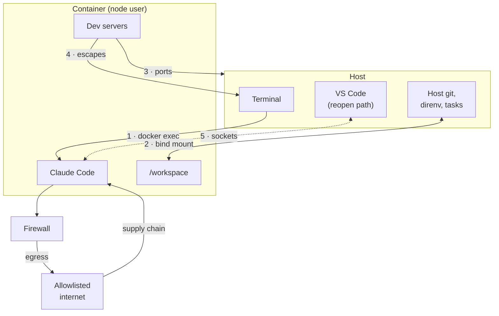

# Harness security model

Threat model for the dev container this boilerplate ships: what a rogue or
prompt-injected agent inside it could reach, what stops it today, and what
does not. Last reviewed 2026-11-13, against commit `fb50130` and later; the second external review of that commit added scenario 3's bypasses.

The README's [Security model](../README.md#310-security-model) section is the
short version. This document is the long one: every channel, every
scenario, the residual risk, and how to check each control by hand.

## Contents

- [1. Scope and trust assumptions](#1-scope-and-trust-assumptions)
  - [1.1 Trusted and not trusted](#11-trusted-and-not-trusted)
  - [1.2 Two ways the container starts](#12-two-ways-the-container-starts)
  - [1.3 Linux hosts](#13-linux-hosts)
- [2. Assets at risk](#2-assets-at-risk)
- [3. Attack surface map](#3-attack-surface-map)
- [4. Threat scenarios](#4-threat-scenarios)
  - [4.1 Widening the firewall by editing the allowlist or the script](#41-widening-the-firewall-by-editing-the-allowlist-or-the-script)
  - [4.2 Disabling or bypassing the firewall from inside](#42-disabling-or-bypassing-the-firewall-from-inside)
  - [4.3 `.git/config` and `.git/hooks`: making the host's git run attacker code](#43-gitconfig-and-githooks-making-the-hosts-git-run-attacker-code)
  - [4.4 `devcontainer.json`: `initializeCommand` runs on the host](#44-devcontainerjson-initializecommand-runs-on-the-host)
  - [4.5 VS Code sockets and `$BROWSER`](#45-vs-code-sockets-and-browser)
  - [4.6 Copied `.gitconfig` and credential helpers](#46-copied-gitconfig-and-credential-helpers)
  - [4.7 Published ports and dev servers](#47-published-ports-and-dev-servers)
  - [4.8 Terminal and clipboard escape sequences](#48-terminal-and-clipboard-escape-sequences)
  - [4.9 Exfiltration through allowed egress](#49-exfiltration-through-allowed-egress)
  - [4.10 Packages executed inside the container](#410-packages-executed-inside-the-container)
  - [4.11 VS Code extensions](#411-vs-code-extensions)
  - [4.12 Image build inputs](#412-image-build-inputs)
  - [4.13 Credentials stored in the config volume and the repo](#413-credentials-stored-in-the-config-volume-and-the-repo)
  - [4.14 Host-side harness files](#414-host-side-harness-files)
- [5. Control matrix: sandbox path versus VS Code reopen](#5-control-matrix-sandbox-path-versus-vs-code-reopen)
- [6. Verification checklist after a rebuild](#6-verification-checklist-after-a-rebuild)
  - [6.1 Firewall](#61-firewall)
  - [6.2 Read-only mounts and git](#62-read-only-mounts-and-git)
  - [6.3 VS Code reopen path](#63-vs-code-reopen-path)
  - [6.4 Sandbox lifecycle](#64-sandbox-lifecycle)
  - [6.5 Host and terminal](#65-host-and-terminal)
- [7. Open items and proposed next controls](#7-open-items-and-proposed-next-controls)
  - [7.1 Proposed controls](#71-proposed-controls)
  - [7.2 Out of scope and accepted](#72-out-of-scope-and-accepted)

## 1. Scope and trust assumptions

The container is the security boundary. Claude Code runs inside it, usually
with permission prompts off (`CLAUDE_SHORTCUT_FLAGS`), so every command the
model chooses to run executes with no human in the loop. The model must be
assumed hostile at any moment: a prompt injection in a README, a web page, a
package description or a GitHub issue is enough to turn it. The question
this document answers is what a hostile process inside the container can
reach, and what stops it.

**Who "the agent" is.** Throughout this document the attacker is called the
agent: the Claude Code process running as the `node` user inside the
container, together with every tool, script and package it runs. It is your
own Claude Code, assumed to have been turned by a prompt injection in a file,
a web page, a package or an issue, or to be running code a malicious package
brought along. No separate attacker needs access to anything; whatever the
agent can do, an injection can make it do. "The agent writes X" therefore
means that process writes X from inside the container. You, the person at
the keyboard, are "the user" or "the human" and are never the actor unless
named.

### 1.1 Trusted and not trusted

**Trusted:** the host (macOS or Linux) and its user, the Docker engine and
the Linux kernel the container runs on, the image build inputs after a human has reviewed
`git diff -- .devcontainer`, the host-side `agent-sandbox.zsh` copy in
`~/.config/zsh`, and the terminal application.

**Not trusted:** anything that runs as the `node` user inside the container
(Claude Code, every tool it calls, every package it installs, every dev
server it starts), the contents of the repository after the agent has
touched them, and anything fetched over the allowed egress.

### 1.2 Two ways the container starts

The two paths have different boundaries:

| | `agent-sandbox` (plain Docker, `scripts/agent-sandbox.zsh`) | VS Code "Reopen in Container" |
| --- | --- | --- |
| Host paths mounted | project folder only | project folder only |
| `.devcontainer`, `.vscode`, `.git/hooks`, `.git/config`, `.git/commondir` | read-only, `.git` is a mount point | read-only via `devcontainer.json` mounts, `.git` is a mount point (since 2026-11-16) |
| Nested repos, submodule configs, worktree commondirs, drift | refused / mounted read-only / verified / gated | only the commondir files are verified (`initialize.sh`) |
| Host channels (SSH agent, keychain, `code` IPC, `$BROWSER`) | none | all open |
| `.gitconfig` | name and email as env vars | whole file copied in |
| `initializeCommand` from `devcontainer.json` | never read | `.devcontainer/initialize.sh` runs on the host at every start: per-host opt-in, commondir guards, mount sources; read-only inside |
| Ports | only those in `agent-sandbox-ports`, loopback | auto-forwarded |

The rest of this document treats the `agent-sandbox` path as the baseline and names
where the VS Code path is weaker. Residual risks that neither path closes
are listed as such.

### 1.3 Linux hosts

The model is the same on Linux; four things sit differently around it, and
they are called out again in the scenarios they affect.

| On Linux | Consequence | Handled by |
| --- | --- | --- |
| No VM between the container and the kernel (Docker Desktop on macOS runs the container inside a VM) | a container escape or in-container root is a host compromise, not a VM compromise | nothing yet; `no-new-privileges` and a user-namespace remap are in the open items (scenario 2) |
| Bind mounts keep host ownership | an image built for uid 1000 cannot write a repo owned by uid 1001 | `agent-sandbox` builds with the host uid/gid and warns on mismatch; VS Code uses `updateRemoteUserUID` |
| The bridge gateway is the host itself | `# allow-host-network` reaches every host service listening on `0.0.0.0`, not a VM | leave the directive off; inbound-only is the default (scenario 7) |
| The Docker socket is root-equivalent on the host | anything in the `docker` group can start a privileged container | the socket is never mounted into the container; user-level hygiene outside this repo |

Terminal and credential-helper notes differ by platform (iTerm2 and the
keychain on macOS; GNOME Terminal, kitty, alacritty and the secret-service
helper on Linux) but the vectors in scenarios 5, 6 and 8 are the same.

## 2. Assets at risk

Five things are worth protecting, in descending order of damage if lost.

| Asset | Where it lives | Loss looks like |
| --- | --- | --- |
| Host machine: files, keychain, SSH keys, other repos | outside the container | any code execution on the host, or a channel that signs or authenticates with host credentials |
| Repository integrity | the bind-mounted `/workspace`, pushed to GitHub | a backdoored commit, a hook or config that runs on the host, a rewritten `.devcontainer` that the next rebuild bakes in |
| Secrets the container holds | `~/.claude` volume (OAuth token), `.claude/settings.local.json` (API keys, Socket token), `.env` files, GitHub token from `gh auth` | exfiltration over any allowed egress, or abuse of the Anthropic account and GitHub access from inside |
| Confidentiality of the code and conversation | `/workspace`, the model context | exfiltration to a host the agent can reach: any GitHub repository, a DNS tunnel, the allowlisted APIs |
| Other containers and services on the host | the Docker bridge network, published ports | lateral movement to sibling service containers; a malicious page served to the host browser via a published dev server |

Two things are explicitly **not** protected and are accepted: the
repository's working tree is writable by design (the agent's job is to edit
it), and prompts plus file contents go to `api.anthropic.com` by design.
Review before commit, and the data-usage terms of the account, are the
controls there.

## 3. Attack surface map

Everything the agent can do to the host goes through five channels between
the container and the host; everything it can send out goes through the
firewall. The `agent-sandbox` path keeps only the first two host channels open, with
read-only guards on the mount; the VS Code path opens all five and copies
`.gitconfig` in. Supply chain runs the other way: code that arrives through
it executes with the agent's reach, and, for VS Code extensions, partly on
the host.

Solid lines are open on both paths; dotted lines only on the VS Code path.

| # | Channel | What crosses it |
| --- | --- | --- |
| 1 | `docker exec … tmux` | the terminal session into the container |
| 2 | Bind mount of the project folder | read-write, so files the host later executes (git config and hooks, `.envrc`, editor tasks) are written here; five paths are mounted read-only on top |
| 3 | Published ports | dev servers reachable from the host browser |
| 4 | Escape sequences | everything printed is rendered by the host terminal |
| 5 | VS Code sockets | SSH agent, keychain, `code` IPC, `$BROWSER` (VS Code path only) |
| – | Egress | through the firewall's ipset allowlist, everything else rejected |
| – | Supply chain | base image, apt, npm and VS Code extensions arrive from the allowed hosts; extensions also run on the host |

The allowlist covers GitHub (all ranges, any repository, any port),
`api.anthropic.com`, `platform.claude.com`, `registry.npmjs.org`, the VS
Code marketplace, and the configured recursive DNS resolvers. GitHub and the
resolvers are the residual exfiltration paths.

On both paths the project folder is bind-mounted read-write, and
`.devcontainer`, `.vscode`, `.git/hooks`, `.git/config` and
`.git/commondir` are bind-mounted again on top of it, read-only: the inner
mount wins for its subtree, so a write there fails instead of landing
anywhere (plain mounts, not OverlayFS). Only the `agent-sandbox` path adds
the dynamic checks.

## 4. Threat scenarios

Each scenario names the vector, what an attacker gains, what stops it today,
what remains, and how to check. "Sandbox path" means a container started by
`scripts/agent-sandbox.zsh`; "VS Code path" means "Reopen in Container".
Scenario numbers match the subsections: "scenario 3" is section 4.3, and the
control matrix and the checklist refer to scenarios by that number. In every
scenario the actor is the agent as defined in section 1: the Claude Code
process inside the container, under prompt injection or running a malicious
package, with no human in the loop.

### 4.1 Widening the firewall by editing the allowlist or the script

- **Vector:** The agent edits `.devcontainer/allowed-domains.txt` or
  `init-firewall.sh` to add an exfiltration host, then waits for a rebuild.

- **Gain:** Permanent egress to a host of its choice from the next image on.

- **Mitigation:** The running firewall reads only the copies baked into the
  image (`/etc/init-firewall/allowed-domains.txt`,
  `/usr/local/bin/init-firewall.sh`), so an edit changes nothing until a human
  rebuilds. On the sandbox path `.devcontainer` is a read-only mount, so the edit
  is impossible; the image carries a sha256 label of `.devcontainer` and
  `agent-sandbox` warns on drift; `agent-sandbox-rebuild` and `agent-sandbox-recreate` list the changes
  and ask.

- **Residual:** On the VS Code path the directory is read-only inside too
  (since 2026-11-16), but "Rebuild Container" asks nothing and there is no
  drift warning: `git diff -- .devcontainer` on the host is the review. In
  `agent-sandbox --setup` it is writable by design. A
  committed edit leaves `git status` clean, so the hash gate, not git, is the
  real check. Humans skimming a diff miss single-line changes to a domain list.

- **Verify:** `touch .devcontainer/x` inside the container fails with
  "Read-only file system"; edit a file on the host and run `agent-sandbox`: the
  warning appears.

### 4.2 Disabling or bypassing the firewall from inside

- **Vector:** The agent runs `iptables -F` or `ipset flush`, or re-runs the
  firewall script with a modified allowlist.

- **Gain:** Unrestricted egress for the rest of the session.

- **Mitigation:** Rule changes need root. The `node` user has `sudo` for
  exactly one command, `/usr/local/bin/init-firewall.sh`, root-owned and 0755,
  which reads only baked files. The capabilities `NET_ADMIN`/`NET_RAW` belong
  to the container, not the user; without root they grant nothing. Rules are
  lost on restart, but `agent-sandbox` checks the OUTPUT policy before every attach and
  re-applies them.

- **Residual:** Any local privilege escalation inside the container (kernel,
  sudo, setuid binary from a package) ends the firewall. The container runs as
  a plain user with the default seccomp profile but no user-namespace remapping
  and no `no-new-privileges`. On a Linux host the same escalation also reaches
  the host kernel directly; on macOS it stops at Docker Desktop's VM. A restart by hand (`docker start`) followed by
  `docker exec` outside `agent-sandbox` gives a shell with no rules until `agent-sandbox` runs.

- **Verify:** `iptables -S` as `node` fails with "Permission denied"; `sudo -l`
  lists only the script.

### 4.3 `.git/config` and `.git/hooks`: making the host's git run attacker code

- **Vector:** The agent writes `core.hooksPath`, `core.fsmonitor`,
  `core.sshCommand`, a `[filter]` driver or an `[include]` into
  `.git/config`, or drops a `pre-commit` hook into `.git/hooks`. Every `git`
  command you later type on the host executes it, as you, outside any
  sandbox.

- **Gain:** Code execution on the host with the user's full rights, triggered
  by `git status`.

- **Mitigation:** Sandbox path: `.git/hooks` and `.git/config` are read-only
  mounts, and `.git` itself is a mount point so it cannot be renamed and
  replaced by a writable copy. `/pr` pushes without `-u`, `ccw` uses
  `--no-track`, so nothing in the harness needs to write them.

  **Two ways around the read-only mounts, both reproduced on git 2.39 and 2.43.**
  They need only what a normal-mode container already has: a writable `.git`
  directory and a writable working tree.

  1. **A `.git/commondir` file.** If it exists, git reads config and hooks
     from the directory it names instead of `.git`. One file write redirects
     the host's git to a config and hooks directory the agent controls; the
     two read-only mounts protect files git no longer reads. Closed on the
     sandbox path (decided 2026-11-14): `agent-sandbox` creates `.git/commondir` on the
     host holding a single `.` (no newline; git 2.39 rejects one, and an
     empty file breaks git) and mounts it read-only beside `.git/config`, so
     the file cannot be created or changed from inside. With that content git
     behaves exactly as without the file (verified for status, commit,
     worktree add and remove, remotes on git 2.39; the second review tested
     2.43). `agent-sandbox` and the gate still refuse when the file holds anything
     else, read with the shell, never with git.
  2. **A submodule entry pointing at a nested repository.** `git init` a
     subdirectory, set `core.fsmonitor` in *its* config (writable, it is not
     under the read-only mounts), `git add` the directory. The host's top-level
     `git status` enters the nested repo and runs the command. Sandbox path
     (decided 2026-11-14): `agent-sandbox` refuses to attach, and the gate refuses,
     while a nested `.git` exists that `.devcontainer/agent-sandbox-nested-repos`
     does not list (one path or glob per line, read on the host, under the
     read-only mount, so the agent cannot list its own). Harness worktrees
     and `node_modules` are never checked. A listed repository is trusted:
     review it as you would any dependency. What keeps the host out of a
     nested repository: the read-only `.git/config` keeps a submodule
     *inactive*, so `fetch`, `pull` and `push` told to recurse skip it; an
     untracked nested repo is not entered by the top-level `git status`
     (verified); and your own discipline, since any git process whose working
     directory is inside it reads its config. `git config
     diff.ignoreSubmodules all` on the host removes the accidental trigger
     (plain `status`, `diff`, `log`, `commit`, `stash`, `checkout`, `add`,
     `gc`, `fsck` and the `--recurse-submodules` forms of `fetch`, `grep`,
     `ls-files` and `push` then spawn no git in a nested repository, verified
     on git 2.39), but it is a reporting setting, not a boundary:
     `--ignore-submodules=none`, `git submodule foreach`, an IDE's repository
     detection when the project is opened on the host, GitLens, or a
     git-aware shell prompt after `cd` into the directory all run its config.
     Prefer exact paths over globs in the allowlist: a glob also admits a
     repository the agent creates under it. For code you do not trust, keep
     the clone off the host altogether (a Docker volume mounted into the
     container, proposed below).
  3. **Two more agent-writable files git reads on the host, found while
     answering "is `core.fsmonitor` covered":** a *registered* submodule's
     config lives in `.git/modules/<name>/config` (writable; the host's
     `git status` reads it: verified), and a *linked worktree* (`ccw`,
     `claude --worktree`) has its own `.git/worktrees/<name>/commondir`
     (writable; git run *inside* that worktree on the host follows it:
     verified; the top-level `git status` and `git worktree list` do not).
     Sandbox path: every existing `.git/modules/**/config` is mounted read-only
     (a submodule added inside is covered from the next `agent-sandbox-recreate`),
     and `agent-sandbox` refuses to attach when any `.git/worktrees/*/commondir` holds
     anything but `../..`.

  **The harness itself must not be the trigger.** Until this review,
  `agent-sandbox-rebuild` ran `git status` in the repo on the host before showing
  anything, which would have executed a planted `core.fsmonitor`. Now
  `agent-sandbox.zsh` runs no git inside the project: the build keeps a copy of
  `.devcontainer` outside the repo (`~/.cache/agent-sandbox/<name>/`) and diffs
  against it; `agent-sandbox --setup` first copies `.git/config` and `.git/hooks`
  there, and `agent-sandbox-rebuild` diffs the live files against those copies and
  asks. The only git call left is `git config --global`, run from `/`.

- **Residual:** VS Code path: the same five read-only mounts and the `.git` mount
  point come from `devcontainer.json`, and `.devcontainer/initialize.sh`
  refuses a redirected `.git/commondir` or worktree commondir before every
  start; but nothing checks nested repositories or mounts
  `.git/modules/**/config` there, and the editor runs git in the repo
  constantly. `.vscode/` is read-only on both paths (created empty on the host
  when missing), so `tasks.json` with `runOn: folderOpen` and
  `settings.json` keys that name binaries are out of reach. Still writable by
  design on both paths: `.envrc` for direnv,
  `Makefile`, `package.json` scripts, a committed `.githooks/` that a README
  tells the user to enable. VS Code's Workspace Trust and direnv's allow step
  are the only gates, and both are one click. A host-side `git config` write
  after the container started is invisible inside until `agent-sandbox-recreate`
  (the mount holds the old inode). A nested repository you listed is trusted
  by you, not checked by the harness.

- **Verify:** Inside: `git config x.y z` fails, `mv .git .git.x` fails with
  "Device or resource busy", `echo ../x > .git/commondir` fails, `cat
  .git/commondir` prints `.`, `touch .vscode/x` fails, and with a registered
  submodule `echo x >> .git/modules/<name>/config` fails. On the host,
  **before running git in the repo**: `cat .git/commondir` prints `.`; `cat
  .git/worktrees/*/commondir` prints only `../..`; `find . -name .git -not
  -path './.git' -not -path './.claude/worktrees/*'` lists only what
  `.devcontainer/agent-sandbox-nested-repos` names; `git config --get
  diff.ignoreSubmodules` prints `all` if any are listed (accident guard, not
  a control); then `git config
  --show-origin --list | grep -E 'hooksPath|fsmonitor|sshCommand|filter'`
  shows nothing unexpected. `grep -c 'git status' ~/.config/zsh/agent-sandbox.zsh`
  prints `0`.

### 4.4 `devcontainer.json`: `initializeCommand` runs on the host

- **Vector:** The Dev Containers extension runs `initializeCommand` on the host
  before the container starts, and `onCreateCommand`, `postCreateCommand`,
  `postStartCommand` inside it. An agent that can write `devcontainer.json`
  adds a host command that runs at the next reopen. `runArgs` can add
  `--privileged`, a Docker socket mount, or `--network host`; `mounts` can
  bind `~/.ssh`; `remoteEnv` can inject variables.

- **Gain:** Host code execution, or a container with no boundary at all, both
  from one JSON edit.

- **Mitigation:** Sandbox path: `agent-sandbox.zsh` never reads `devcontainer.json`
  except two single-line values (`CLAUDE_SHORTCUT_FLAGS`, validated against
  `^(--[a-z0-9-]+( |$))*$`, and `CLAUDE_CODE_VERSION`, validated as a version
  string), and the file is read-only. The container's options are fixed in
  `agent-sandbox.zsh`, which lives outside the repo. VS Code path (since 2026-11-16):
  `.devcontainer/` is read-only inside, so the agent cannot add a host
  command or change `runArgs`, `mounts` or `remoteEnv` from the container.
  The one `initializeCommand` is `.devcontainer/initialize.sh`, which refuses
  to start the container unless reopen is enabled on this host
  (`AGENT_SANDBOX_ALLOW_VSCODE=1` or `~/.config/zsh/agent-sandbox-allow-vscode`, both outside
  the repository), checks the commondir files, and never runs git.

- **Residual:** VS Code path: an edit made on the host, or shipped by a cloned
  repository, still runs at the next start; the extension does not warn.
  Review `git diff -- .devcontainer` before every rebuild. The agent could
  write `.devcontainer.json` at the repo root (writable); VS Code prefers
  `.devcontainer/devcontainer.json` when both exist, and `.vscode/settings.json`
  is read-only now. A fresh clone with an untrusted `devcontainer.json`
  is the untrusted-repository case, which no mount can cover.

- **Verify:** `grep -n -A3 initializeCommand .devcontainer/devcontainer.json`
  on the host shows only the `initialize.sh` array and `git diff --
  .devcontainer/initialize.sh` is empty; reopen without the opt-in fails with
  the script's message;
  `docker inspect <container> --format '{{.HostConfig.Privileged}} {{.HostConfig.NetworkMode}} {{json .Mounts}}'`
  shows `false bridge` and only the project mounts and two volumes.

### 4.5 VS Code sockets and `$BROWSER`

- **Vector:** On the VS Code path the agent's environment holds `SSH_AUTH_SOCK` (host
  agent forwarded), `VSCODE_IPC_HOOK_CLI` (the `code` CLI socket),
  `REMOTE_CONTAINERS_IPC` (extension-host IPC that can run extension commands
  on the host), `GIT_ASKPASS` (host keychain helper), and `$BROWSER` set to
  `code --openExternal`.

- **Gain:** Sign and authenticate as the user with keys that never leave the
  host (push anywhere, SSH anywhere the key opens). Open any URL in the host
  browser, past the firewall: exfiltration in a query string, phishing,
  `file://` or custom URL schemes that launch host applications. Run
  `code --command` and extension commands on the host.

- **Mitigation:** Sandbox path: none of these exist; the probe is
  `env | grep -E 'SSH_AUTH_SOCK|VSCODE_IPC|REMOTE_CONTAINERS|GIT_ASKPASS|BROWSER'`
  returning nothing.

- **Residual:** VS Code path: blanking the variables through `remoteEnv` only
  hides them from processes that honour the environment. The sockets still
  exist under `/tmp` and `/root/.vscode-server`, and the host still answers on
  them; a process can find them with `find / -type s`. Treat the VS Code path
  as "the agent can use my SSH agent and open URLs on my machine".

- **Verify:** On the sandbox path the `env` probe is empty and
  `find / -type s 2>/dev/null` lists only Docker's own and tmux's sockets.

### 4.6 Copied `.gitconfig` and credential helpers

- **Vector:** On the VS Code path the extension copies the host `~/.gitconfig`
  into the container, where the agent can read it. A
  `credential.helper = osxkeychain` line does not work in Linux, but the
  extension installs its own helper that proxies to the host keychain.
  `git credential fill` then returns the user's GitHub token to anything in the
  container.

- **Gain:** The user's GitHub identity: push to any repo they can write to,
  read private repos, through the allowed GitHub egress.

- **Mitigation:** Sandbox path: only `user.name` and `user.email` are passed, as
  environment variables. No helper, no `.gitconfig`. GitHub access inside comes
  only from what the user signs in to deliberately (`gh auth login`), and that
  token is the agent's to use, which is by design for `/pr`.

- **Residual:** `gh auth` tokens and the Claude OAuth token in the `~/.claude`
  volume are readable by the agent; see scenario 13. Env-var identity
  overrides a per-repo `user.email`.

- **Verify:** Inside: `git config --show-origin credential.helper` prints
  nothing; `cat ~/.gitconfig` fails.

### 4.7 Published ports and dev servers

- **Vector:** A dev server the agent starts is reachable from the host browser
  (auto-forwarded by VS Code, or listed in `agent-sandbox-ports`). The agent controls
  every byte it serves. Inside the bridge network the server binds `0.0.0.0`,
  so sibling containers reach it too.

- **Gain:** A malicious page in the user's browser: JavaScript on
  `localhost:<port>` can probe other local services (CSRF to anything without
  auth on loopback), prompt for credentials under a trusted-looking origin, or
  exploit a browser bug.

- **Mitigation:** Sandbox path publishes only ports named in `agent-sandbox-ports`, on
  `127.0.0.1`, with an ephemeral host port; the file is under the read-only
  mount, so the agent cannot add ports. Nothing is published by default.
  Inbound to the container is limited to the gateway network. Outbound to that
  network is off unless `# allow-host-network` is set; on Linux the gateway is
  the host itself, so keep it off there unless the sibling containers really
  need it.

- **Residual:** The user opens the URL in their everyday browser with their
  everyday sessions. VS Code forwards any port the container opens, with a
  notification but no decision. This is inherent to running a dev server you
  did not write; the control is to treat the page as untrusted content.

- **Verify:** `docker port <container>` lists only the intended ports, all on
  `127.0.0.1`.

### 4.8 Terminal and clipboard escape sequences

- **Vector:** Everything the agent prints is rendered by the host terminal. OSC
  52 writes the host clipboard; title-setting sequences plus "report title"
  answer-backs inject text into the shell input; terminal emulators have had
  code-execution bugs in escape-sequence parsing (iTerm2 CVE-2026-41253;
  several in the `tmux -CC` control-mode path; Linux terminals have had their
  own).

- **Gain:** Paste a prepared command into the user's clipboard, inject
  keystrokes, or exploit the terminal.

- **Mitigation:** `/etc/tmux.conf` sets `set-clipboard off` and
  `allow-passthrough off`, so tmux does not forward OSC 52 or raw passthrough
  sequences. README asks for iTerm2 3.6.10 or later, no `tmux -CC`, and
  "Terminal may report window title" off; on Linux, check the terminal's own
  OSC 52 and title-report settings.

- **Residual:** Any pane can run `tmux set -g set-clipboard on`; the config is
  a default, not an enforcement. `agent-sandbox --no-tmux` and `docker exec` shells
  bypass tmux entirely. The terminal's own parser is the trust boundary and is
  outside this repo.

- **Verify:** Inside tmux: `tmux show -g set-clipboard` prints `off`.

### 4.9 Exfiltration through allowed egress

- **Vector:** Even with the firewall intact, the agent can send data to
  anything on the allowlist.

- **Gain:** Code, secrets, or conversation contents leave the machine.

  **Channels that remain open, in order of capacity:**

  | Channel | Why it works | Capacity |
  | --- | --- | --- |
  | Any GitHub repository | the ipset holds GitHub's IP ranges; an injected prompt can carry its own token and `git push` to an attacker's repo, or open an issue with `gh` | unlimited |
  | DNS | queries go to the configured resolver, which is recursive and resolves any name; data rides in query names (`<base32>.attacker.example`) | tens of bytes per query, thousands of queries per minute |
  | `api.anthropic.com` | prompts and tool output go there by design | by design; governed by account data terms |
  | `registry.npmjs.org` | `npm publish` with a token the agent holds | needs a token |
  | Allowlisted project APIs | anything added for the stack with an authenticated write path | per service |

- **Mitigation:** Closed since this review: TCP 22 anywhere, UDP 53 anywhere,
  the host /24, `sentry.io`, `statsig.com`, all IPv6.

- **Residual:** The first two rows. The proposed controls are a filtering
  resolver that answers only allowlisted names (closes DNS tunnelling) and an
  egress proxy that restricts GitHub to this project's repositories (closes the
  GitHub row). Neither exists yet.

- **Verify:** `dig +short @1.1.1.1 example.com` returns nothing;
  `dig +short example.com` returns an address (resolver works, so the tunnel
  is narrowed, not closed).

### 4.10 Packages executed inside the container

- **Vector:** The agent (or you) runs `npm install` of a malicious or
  typosquatted package, `npx` of arbitrary code, a `postinstall` script, or a
  dependency's code at test time. Here the agent may be the victim rather than
  the attacker: the package's code then has the agent's reach.

- **Gain:** The agent's reach, nothing more: the package runs as `node` inside
  the same boundary. It cannot do anything the agent itself could not.

- **Mitigation:** `.npmrc` sets `ignore-scripts=true` and exact pins;
  lockfiles; the optional Socket scan hook. The firewall limits what the
  package can call home to. Supply-chain hardening recipes per stack in
  `STACKS.md`.

- **Residual:** `ignore-scripts` stops install-time execution only;
  `node_modules` code runs at `require` time regardless. A package can read the
  same secrets the agent can (scenario 13). On the host, if the user runs
  `npm install` or `npm test` in the same checkout outside the container, the
  package runs on the host with the user's rights.

- **Verify:** `npm config get ignore-scripts` prints `true` inside the
  container.

### 4.11 VS Code extensions

- **Vector:** No agent action is needed: `devcontainer.json` lists extensions
  that the Dev Containers extension installs automatically into the
  container's extension host. Some
  extensions, and all UI extensions, run on the host. A malicious or
  compromised extension (marketplace takeover, maintainer account compromise)
  has at least the agent's reach plus the VS Code channels of scenario 5, and
  on the host side the user's rights.

- **Gain:** Host code execution through the extension host, or the full
  scenario-5 channel set without even needing the agent.

- **Mitigation:** The list is four well-known publishers (`anthropic`,
  `dbaeumer`, `esbenp`, `eamodio`). Marketplace hosts are on the firewall
  allowlist only for this path. The sandbox path installs no extensions and does
  not contact the marketplace.

- **Residual:** The extensions list in `devcontainer.json` changes only from
  the host now (read-only inside since 2026-11-16). `.vscode/extensions.json` recommendations
  prompt the user on the host. Extension auto-update is a persistent
  supply-chain exposure independent of this harness.

- **Verify:** `code --list-extensions` in the container matches the four
  listed; on the sandbox path the command does not exist.

### 4.12 Image build inputs

- **Vector:** No agent action is needed: the image pulls `node:22-bookworm` by tag, Debian packages,
  `npm@latest`, `@anthropic-ai/claude-code@latest`, and two sha256-pinned
  downloads (git-delta, zsh-in-docker). A compromised upstream enters the image
  at rebuild.

- **Gain:** Code in the image runs as `node` (or root during build) inside the
  container; a compromised Claude Code binary would hold the OAuth token and
  act as the agent.

- **Mitigation:** Two downloads are hash-pinned and fail the build on
  mismatch. `agent-sandbox-rebuild` uses `--pull --no-cache` so the inputs are the
  current upstream, not a stale layer. The build fails on `claude --version`
  if the install is broken.

- **Residual:** The base image and Claude Code are not digest-pinned; `latest`
  is a trust-the-publisher decision made at each rebuild. The build itself
  runs on Docker Desktop with network access and could be the first point
  where an attacker-controlled registry answers.

- **Verify:**
  `docker image inspect <image> --format '{{index .Config.Labels "agent-sandbox.devcontainer-sha256"}}'`
  matches the hash of the reviewed `.devcontainer`; pin `CLAUDE_CODE_VERSION`
  in `devcontainer.json` if reproducibility matters.

### 4.13 Credentials stored in the config volume and the repo

- **Vector:** The agent can read the `~/.claude` volume, which holds the OAuth token (and memory, which
  can carry anything the agent chose to remember). `.claude/settings.local.json`
  may hold `ANTHROPIC_API_KEY` or `SOCKET_CLI_API_TOKEN`. `gh auth` stores a
  GitHub token. `.env` files hold project secrets.

- **Gain:** The agent reads its own credentials and sends them out through
  scenario 9; an attacker then uses the Anthropic account or GitHub access
  from elsewhere.

- **Mitigation:** The firewall limits where they can be sent. `.env*` and
  `settings.local.json` are gitignored, so they do not leak through a commit.
  The volume is per project name, not shared across projects.

- **Residual:** Inherent: a process that must authenticate holds the
  credential. Scope tokens narrowly (GitHub fine-grained token for this
  repository only; a Console API key with a spend limit rather than a
  subscription OAuth token where exfiltration risk matters). Rotate after any
  suspected injection.

- **Verify:** `gh auth status` shows a token scoped to what the project needs;
  no `.env` is tracked (`git ls-files | grep -i env`).

### 4.14 Host-side harness files

- **Vector:** `~/.config/zsh/agent-sandbox.zsh` decides what the container sees. If it
  were a symlink into a repo, or lived in a dotfiles repo the agent can edit,
  the next `agent-sandbox` would run attacker code on the host. `scripts/sync-harness.sh`
  runs on the host and copies files from the boilerplate checkout into other
  projects. `.claude/hooks/*.py` and `settings.json` hooks run wherever Claude
  Code runs: in the container normally, but on the host if someone starts
  `claude` there.

- **Gain:** Host code execution at the next `agent-sandbox` or the next Claude session
  on the host.

- **Mitigation:** `--install-shell` refuses a symlinked file or directory,
  copies with `install -m 0644`, shows a diff before replacing, prints the
  version and SHA-256. The header tells the user to keep it outside any
  agent-writable folder. Claude Code's workspace trust gates project hooks on
  first open.

- **Residual:** Running `sync-harness.sh` from a boilerplate checkout an agent
  has modified propagates that modification; review the boilerplate's own diff
  first. Running Claude on the host at all removes every control in this
  document except the deny list and `block_destructive.py`.

- **Verify:** `ls -l ~/.config/zsh/agent-sandbox.zsh` shows a regular file, mode 0644;
  `shasum -a 256` of it matches the repo's `scripts/agent-sandbox.zsh` at the reviewed
  commit.

## 5. Control matrix: sandbox path versus VS Code reopen

The `agent-sandbox` path closes every host channel except the mount it needs; the VS
Code path leaves five open. Nothing in either path closes the two egress
channels at the bottom.

| Channel | `agent-sandbox` (plain Docker) | VS Code reopen | Scenario |
| --- | --- | --- | --- |
| `.devcontainer` edits reach the next build | read-only mount, hash drift warning, review gate on rebuild | read-only mount; no warning, no gate | 1, 4 |
| Firewall changed from inside | root only, sudo limited to the baked script | same | 2 |
| First-start firewall failure | container stopped | loopback-only DROP table until restart (exit trap) | 2 |
| `.git/config`, `.git/hooks` executed by host git | read-only, `.git` is a mount point, `.git/commondir` is a read-only placeholder, `.git/modules/**/config` read-only, worktree commondirs verified, unlisted nested repos refused | read-only, `.git` is a mount point, placeholder read-only, commondirs verified by `initialize.sh`; module configs and nested repos unchecked | 3 |
| `.vscode/` executed by the editor on open | read-only | read-only, and the editor is attached | 3 |
| Harness runs git in the repo on the host | never (diffs against copies kept outside the repo) | the editor does, constantly | 3 |
| `initializeCommand` runs on the host | never read | fixed to `initialize.sh` (opt-in, guards); editable only from the host | 4 |
| `runArgs`, `mounts`, `remoteEnv` from the repo | ignored; options fixed in `agent-sandbox.zsh` | honoured; editable only from the host | 4 |
| Reopen path enabled | n/a | per-host switch outside the repo, else the container does not start | 4 |
| SSH agent, keychain helper, `code` IPC | absent | present; `remoteEnv` only hides them | 5, 6 |
| `$BROWSER` opens host URLs | absent | present | 5 |
| `.gitconfig` | name and email only | whole file plus credential proxy | 6 |
| Published ports | `agent-sandbox-ports` list, loopback, ephemeral | every opened port, auto-forwarded | 7 |
| Terminal escape sequences | tmux defaults off clipboard and passthrough | VS Code terminal, its own handling | 8 |
| GitHub-wide egress | open | open | 9 |
| DNS tunnelling via the resolver | open, narrowed to configured resolvers | same | 9 |
| Package code runs in the container | inside the boundary | inside the boundary | 10 |
| Extensions | none installed | four installed; list editable only from the host | 11 |
| Image inputs pinned | two sha256 pins; base and Claude Code by tag | same | 12 |
| Credentials readable by the agent | OAuth token, `gh` token, local settings | same, plus host keychain via helper | 13 |
| Host-side harness files | installed copy outside repos, symlinks refused | n/a | 14 |

## 6. Verification checklist after a rebuild

Run these on the host and inside the container after `agent-sandbox-rebuild`.
Each line maps to a scenario above; a failure means the control is not in
place, whatever the code says.

### 6.1 Firewall

- [ ] `curl https://example.com` fails inside; `curl https://api.github.com/zen` works (firewall active, allowlist works)
- [ ] `timeout 5 bash -c 'exec 3<>/dev/tcp/gitlab.com/22'` fails at once, not by timeout (no blanket SSH; there is no `nc` in the image)
- [ ] `dig +short @1.1.1.1 example.com` returns nothing; `dig +short example.com` returns an address (DNS only to the configured resolver)
- [ ] `sudo /usr/local/bin/init-firewall.sh` on the live container ends with every "Verification passed" line (re-run works, fail-closed)
- [ ] If `ip -6 route show default` prints a route, `curl -6 https://api.github.com` fails (IPv6 blocked)
- [ ] `iptables -S` as `node` is denied; `sudo -l` lists only the firewall script (scenario 2)
- [ ] `claude` sign-in and a normal session work without `sentry.io` and `statsig.com` on the allowlist

### 6.2 Read-only mounts and git

- [ ] `touch .devcontainer/x`, `git config x.y z`, `mv .git .git.x` all fail inside (scenarios 1, 3)
- [ ] Inside: `echo ../x > .git/commondir` fails (read-only), `cat .git/commondir` prints `.`, `touch .vscode/x` fails (scenario 3)
- [ ] `git status`, `git commit`, `ccw x` and `git push` work inside with the placeholder in place; `git status` and the editor work on the host (scenario 3)
- [ ] Inside: `git init vendor/x`; on the host `agent-sandbox` refuses and names `vendor/x`; list it in `.devcontainer/agent-sandbox-nested-repos`; `agent-sandbox` attaches (scenario 3)
- [ ] Inside: `ccw t`, then write anything but `../..` to `.git/worktrees/t/commondir`; on the host `agent-sandbox` refuses and names the file; restore `../..` (scenario 3)
- [ ] In a project with a registered submodule listed in `agent-sandbox-nested-repos`: inside, `echo x >> .git/modules/<name>/config` fails (scenario 3)
- [ ] `/pr` on a feature branch, `ccw test`, and `claude --worktree test` work with the read-only `.git/config`; report any config-write complaint

### 6.3 VS Code reopen path

- [ ] VS Code path: force a first-start failure (a temporary bogus domain in the allowlist, rebuild); from a `docker exec` shell both `curl https://example.com` and `curl https://api.github.com/zen` fail and the postStart log ends with "all egress is blocked until the container restarts" (scenario 2)
- [ ] VS Code path without the opt-in: "Reopen in Container" fails and the Dev Containers log shows the `initialize.sh` message; after `touch ~/.config/zsh/agent-sandbox-allow-vscode` it starts, and inside `touch .devcontainer/x`, `touch .vscode/x`, `git config x.y z`, `echo x > .git/commondir` and `mv .git .git.x` all fail (scenarios 3, 4)
- [ ] VS Code path: plant `../x` in `.git/commondir` on the host; reopen fails with the DANGER message; restore `.` (scenario 3)

### 6.4 Sandbox lifecycle

- [ ] `agent-sandbox --setup`, append a comment line to `.git/config` inside, exit; `agent-sandbox-rebuild` shows that line in a diff and asks (scenario 3)
- [ ] `agent-sandbox-stop` then `agent-sandbox` prints "applying firewall" and the first three checks still hold
- [ ] `agent-sandbox --setup`, `/init`, exit, plain `agent-sandbox` refuses; `agent-sandbox-rebuild` lists the `.devcontainer` changes and asks; afterwards `agent-sandbox` attaches
- [ ] Edit a file under `.devcontainer` on the host, run `agent-sandbox`: the drift warning appears and it still attaches
- [ ] With a port in `agent-sandbox-ports`, `agent-sandbox-recreate` then `agent-sandbox-ports` shows a `127.0.0.1:<port>` mapping and the dev server answers there (also confirms inbound arrives from the gateway network)
- [ ] `docker inspect <container> --format '{{.HostConfig.Privileged}} {{.HostConfig.NetworkMode}}'` prints `false bridge`; its mounts are the project folder, `.git`, the read-only mounts (`.devcontainer`, `.vscode`, `.git/config`, `.git/hooks`, `.git/commondir`, any `.git/modules/*/config`) and two volumes (scenario 4)
- [ ] `env | grep -E 'SSH_AUTH_SOCK|VSCODE_IPC|REMOTE_CONTAINERS|GIT_ASKPASS|BROWSER'` prints nothing (scenario 5)

### 6.5 Host and terminal

- [ ] Inside tmux, `tmux show -g set-clipboard` prints `off` (scenario 8)
- [ ] On the host, `ls -l ~/.config/zsh/agent-sandbox.zsh` is a regular file, mode 0644, and its SHA-256 matches `scripts/agent-sandbox.zsh` at the reviewed commit (scenario 14)

## 7. Open items and proposed next controls

The two egress channels in scenario 9 are the largest remaining gaps;
everything else residual is either inherent to the task or confined to the
VS Code path.

### 7.1 Proposed controls

In rough order of value per effort:

| Control | Closes | Cost and trade-off | Status |
| --- | --- | --- | --- |
| Filtering DNS resolver in the container (dnsmasq bound to loopback, answers only allowlisted names and GitHub; firewall allows upstream 53 only for its uid via `-m owner`) | DNS tunnelling (scenario 9) | one image layer above the marker, a start step in `init-firewall.sh`, a self-test; CDN hostnames with many aliases need listing | proposed, awaiting decision |
| Egress proxy for GitHub and npm that restricts GitHub to this project's repositories and npm to reads | GitHub-wide exfiltration (scenario 9) | large: GitHub API, web and git share hosts, so a CONNECT allowlist is not enough; needs URL rewriting to a proxy that enforces repository names, or a fine-grained token as the only credential | proposed, design first |
| Trim `.claude/settings.json` auto-allow (`curl`, `gh`, `node`, `npx`, `python`, `WebFetch`) | makes prompts meaningful on the VS Code path and in `agent-sandbox --setup` | a prompt on most tool calls; pointless where `CLAUDE_SHORTCUT_FLAGS` skips prompts anyway | decision needed |
| Digest-pin `node:22-bookworm` and pin `CLAUDE_CODE_VERSION` | base-image and Claude Code supply chain (scenario 12) | a hash to bump on every refresh; `cc-update` still works between rebuilds | easy, not started |
| `--security-opt no-new-privileges` and a user-namespace remap in `agent-sandbox.zsh` | privilege escalation inside the container (scenario 2); on Linux hosts this is also host protection, since no VM sits in between | `no-new-privileges` breaks `sudo`, so the firewall would have to run from `agent-sandbox.zsh` as `docker exec -u root` only (which it already can); userns remap changes bind-mount ownership on Linux hosts, usually harmless on Docker Desktop | investigate |
| Fine-grained GitHub token scoped to this repository for `gh auth` inside the container | blast radius of a leaked token (scenario 13) | per-project token management | user practice, document in README |
| Read-only `.claude/` mount (hooks, `settings.json`) on the sandbox path | the agent editing the hooks that screen its own commands | `/remember`, `update-config`, the status line and the `log`/`update-status` skills write there; would need a split between code and state | deferred (decided 2026-11-14) |
| Nested repositories in a Docker volume: an opt-in list (`.devcontainer/agent-sandbox-volumes`) of paths `agent-sandbox` mounts as named volumes, so an audit clone never exists on the host filesystem | the whole nested-repository class on the host (scenario 3): no host git, IDE or prompt can reach it, nothing to allowlist | code not browsable from a host editor; lives only as long as the volume; not available on the reopen path without a devcontainer.json edit | proposed 2026-11-16 |
| VS Code path: attach to the `agent-sandbox` container instead of reopen (README instructions plus an attached-container configuration for the extensions) | the dynamic checks (nested repos, module configs, drift gate) on the editor path | attach ignores `devcontainer.json` customizations; `postCreateCommand` steps already live in the image | document, not started |
| VS Code path: nested-repo and `.git/modules/**/config` checks in `initialize.sh` | scenario 3 on the reopen path | exact-path allowlist parsing in POSIX sh; mounts cannot be added dynamically, so module configs can only be refused, not mounted | not started |
| Nested-repos allowlist: exact paths only, refuse entries added since the last recreate | an agent-created repository admitted by a glob (scenario 3) | projects listing many audit targets type more lines | small, not started |
| `agent-sandbox` refuses to start when a `.git/modules/**/config` exists that the running container does not mount | a submodule registered inside after `agent-sandbox-recreate` (scenario 3) | one more mount comparison at start | small, not started |

### 7.2 Out of scope and accepted

The model's own access to repository contents and the conversation, the
user's browser as the viewer of agent-served pages, and the terminal
emulator's parser.
